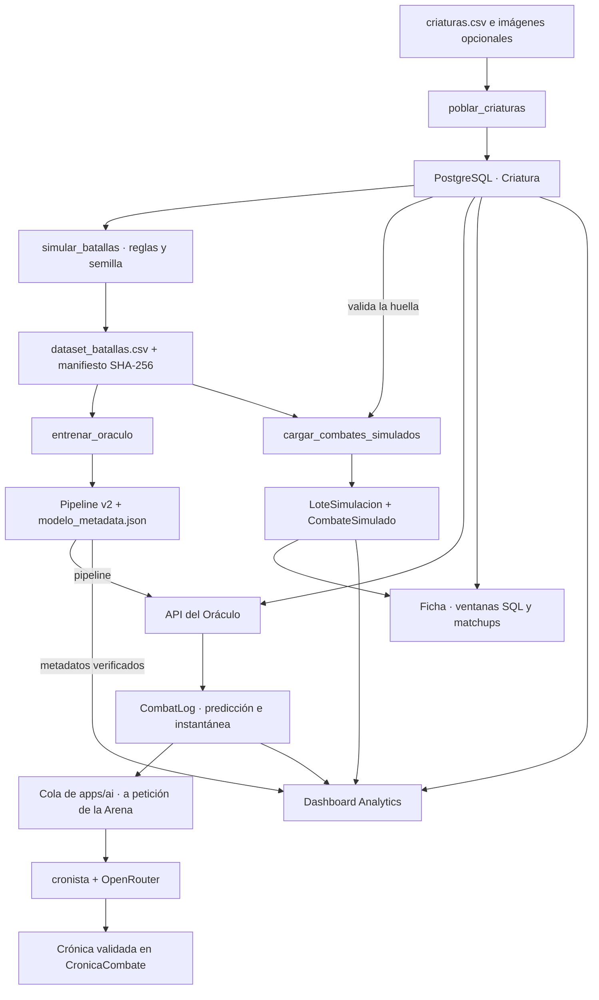

# Arquitectura de MithoWorld

MithoWorld es un monolito modular de Django 5.2 con cuatro dominios y una base PostgreSQL 16. Hay tres clases de datos con ciclos de vida distintos: el catálogo describe las criaturas actuales, los hechos de simulación pertenecen a un lote reproducible y `CombatLog` registra las predicciones solicitadas en la Arena. Los resultados del clasificador y las tasas históricas se pueden consultar por separado.

## Dominios y composición

| Dominio | Datos y comportamiento propios | Dependencias |
|---|---|---|
| `apps/game` | `Criatura`, `CombatLog`, reglas elementales, huella del catálogo y firma de referencias. Sirve la galería, la ficha, la Arena y la API de lectura del catálogo. | Es el núcleo. La ficha recibe su lector analítico como argumento. |
| `apps/ml` | Simulación, entrenamiento, inferencia, metadatos y API del Oráculo. Persiste el resultado de cada predicción exitosa. | Usa las entidades, reglas y atributos canónicos de `game`. |
| `apps/analytics` | `LoteSimulacion`, `CombateSimulado`, carga ELT, consultas SQL de perfil y matchups, dashboard público. | Lee el catálogo y la telemetría de `game`. La vista del dashboard recibe un proveedor de metadatos. |
| `apps/ai` | `CronicaCombate`, `PresupuestoDiario`, cola PostgreSQL y cliente HTTP de OpenRouter. | Lee la instantánea de `CombatLog` y verifica su referencia mediante `game`. |

`backend/urls.py` conecta las vistas con servicios de otros dominios. Para `/criatura/<id>/`, inyecta `analytics.services.obtener_perfil_completo` en `game.views.detalle_criatura`. Para `/analytics/`, inyecta `ml.metadata.leer_metricas_modelo` en `analytics.views.dashboard_universo`. Así `game` puede presentar la ficha sin importar `analytics`, y el dashboard puede mostrar la evaluación sin importar `ml`. Las rutas de API se delegan a cada app. Los labels históricos `criaturas` y `oraculo` conservan la identidad de las migraciones de Game y ML. [Composición de rutas](backend/urls.py)

## Del catálogo a los dos consumidores del dataset

### Pipeline ML v2

El simulador toma parejas del catálogo ordenado por PK, aplica ruido reproducible con `--seed` y escribe 10 000 duelos. Las reglas incorporan ataque, defensa, velocidad y salud. En criaturas de doble tipo, ponderan el primario con 2/3 y el secundario con 1/3. Simulador e inferencia comparten la normalización y el cálculo elemental. El CSV conserva los tres IDs de origen, las doce entradas del modelo y la etiqueta binaria `gano_primero`. El manifiesto identifica tanto el archivo como el catálogo que lo produjo. [Reglas de combate](apps/game/rules.py) · [Contrato del catálogo](apps/game/catalog.py)

El entrenamiento valida el CSV v2, el manifiesto y la coherencia entre ganador y etiqueta. `GroupShuffleSplit` agrupa por pareja sin orientación para que A/B y B/A pertenezcan a la misma partición. Un único `Pipeline` combina ocho stats numéricos, cuatro tipos categóricos con `OneHotEncoder(handle_unknown="ignore")` y un `RandomForestClassifier`. El directorio `apps/ml/ml_models/` contiene el pipeline serializado y sus metadatos de evaluación, semillas, fecha, particiones y huellas. [Entrenamiento](apps/ml/management/commands/entrenar_oraculo.py) · [Metadatos del artefacto](apps/ml/ml_models/modelo_metadata.json)

### Arena y Crónica del Oráculo

El POST a `/api/oraculo/predecir/` carga el pipeline bajo demanda por worker. La medida `metricas.latencia_ms` abarca la preparación del vector, `predict` y `predict_proba`. Después del intervalo, un único INSERT en `CombatLog` guarda ganador, confianza, métricas e instantánea del duelo. La respuesta entrega `resultado` y `metricas`, más las cabeceras `X-Combat-Log-Id` y `X-Combate-Referencia`. El GET a `/api/oraculo/combates/` devuelve las últimas diez predicciones. [Servicio de inferencia](apps/ml/services.py) · [API del Oráculo](apps/ml/views.py)

El botón de crónica usa esa referencia firmada, válida durante 15 minutos, en un POST vacío a `/api/ai/combates/<id>/cronica/`. La Arena recibe 202 y consulta el mismo recurso por GET. La relación uno a uno con `CombatLog` permite reutilizar la crónica terminada. El consumidor reserva el intento y su presupuesto diario en una transacción corta, termina la transacción y hace la llamada HTTP. El LLM selecciona hechos, orden y variantes. El servidor valida el plan de 2–4 líneas e incorpora los nombres y valores de la instantánea. Sin credenciales, la Arena muestra el estado de demo. [Cola y presupuesto](apps/ai/cola.py) · [Validación narrativa](apps/ai/narrativa.py)

### Hechos de simulación y consultas SQL

- **Carga.** `analytics_lotesimulacion` identifica cada lote por el SHA-256 del CSV. Un índice único parcial admite un solo lote activo. En `analytics_combatesimulado` la clave única es `(dataset_sha256, fila_num)`. El cargador valida las huellas, inserta en bloques y desactiva el lote anterior antes de activar el entrante. Los IDs de origen permanecen en los hechos si se elimina una criatura y su FK pasa a `NULL`. [Modelos](apps/analytics/models.py) · [Carga atómica](apps/analytics/management/commands/cargar_combates_simulados.py)
- **Ficha.** Sobre el catálogo completo, las ventanas calculan el rango y percentil por suma de los cuatro stats y las medias por tipo primario. Para los matchups del lote activo, `UNION ALL` reúne ambos lados del duelo. Se exigen ocho encuentros por rival para destacar el más favorable y la némesis. Una ficha existente cuesta tres consultas y un 404 cuesta una. [SQL del perfil](apps/analytics/sql/perfil_criatura.sql) · [SQL de matchups](apps/analytics/sql/matchups_criatura.sql)
- **Dashboard.** Una consulta devuelve los KPIs, la distribución del catálogo y las victorias frente a otros tipos primarios. Los duelos espejo y los que han perdido un participante se cuentan en el lote y se excluyen de la tasa entre tipos. La clasificación usa el tipo primario actual. El proveedor de ML verifica el SHA-256 del pipeline y permite indicar si las métricas proceden de otro dataset. [SQL del dashboard](apps/analytics/sql/dashboard_universo.sql) · [Verificación del modelo](apps/ml/metadata.py)

## Procesos y almacenamiento en GCP

Cloudflare Tunnel comunica el dominio público con Gunicorn en `web:8000` a través de la red interna de Docker. El servicio web inicia con migraciones y `collectstatic`, y usa dos workers con dos hilos cada uno. WhiteNoise sirve los estáticos. Django sirve los retratos del volumen de medios. PostgreSQL y medios conservan sus datos en los volúmenes `mitho_pg_data_v2` y `mitho_media_data_v2`. El dataset publicado y los artefactos de ML viajan en la imagen. [Compose de producción](docker-compose.prod.yml)

El perfil `ai` añade `cronista`, que comparte imagen y base de datos con la web. Su registro Django carga únicamente `game` y `ai`. La generación admite un trabajo simultáneo y usa el presupuesto persistido por día UTC. ML y AI tienen ámbitos de throttling por IP independientes. En producción los workers web comparten los contadores aproximados de DRF mediante `FileBasedCache`. [Configuración del consumidor](backend/settings_cronista.py) · [Resolución de IP](backend/throttling.py)

El flujo de desarrollo y despliegue está en la portada. La bitácora conserva los contratos y sus verificaciones. El ADR registra las decisiones que permitieron migrar las apps existentes. [Guía de operación](README.md) · [Bitácora](IMPLEMENTATION_PHASES.md) · [ADR histórico](ARCHITECTURE_MIGRATION.md)
