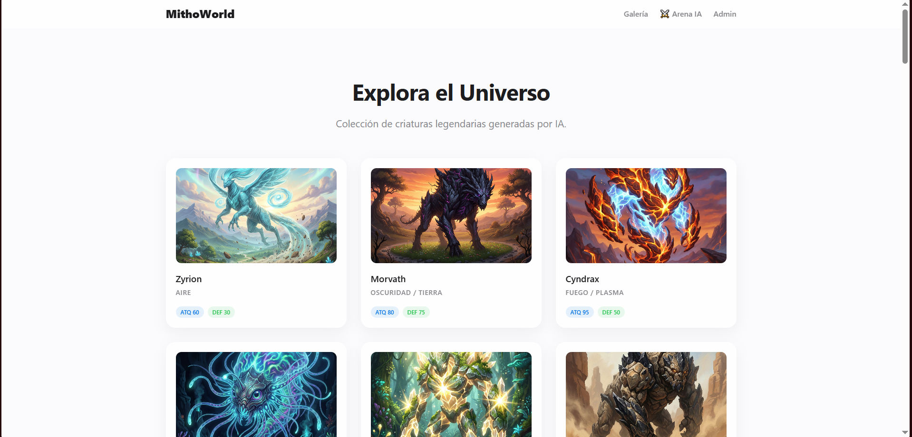
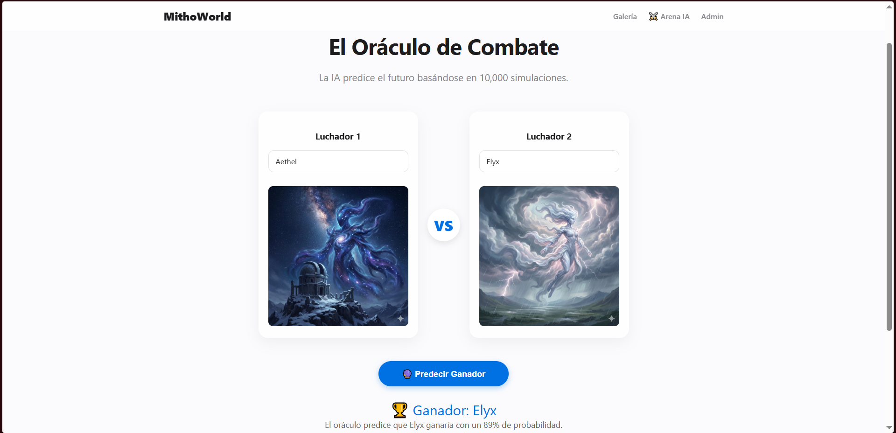
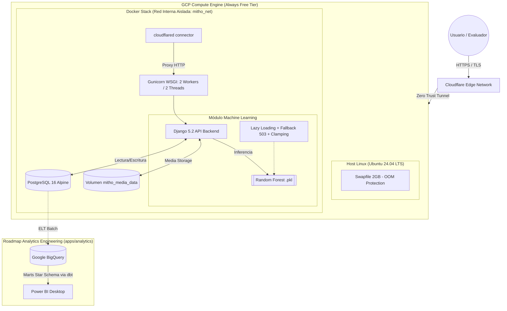

# 🐉 MithoWorld V2.0: Battle Engine & AI Predictive Analytics
-success)


Plataforma Full Stack orientada a Ingeniería de Datos y Machine Learning. El sistema implementa un motor de combate RPG por turnos y un oráculo predictivo basado en Machine Learning, desplegado en infraestructura Cloud desacoplada y protegido perimetralmente con arquitectura Zero Trust.

🔗 **Demo en Producción:** [https://mithoworld.yurack.com](https://mithoworld.yurack.com)  
📄 **Blueprint de Arquitectura Modular:** Consulta [`ARCHITECTURE_MIGRATION.md`](ARCHITECTURE_MIGRATION.md). Fases 1 (`apps/game`) y 2 (`apps/ml`) completadas e integradas; `apps/analytics` y `apps/ai` ya cuentan con scaffolding activo.

---

## 📸 Interfaz de Usuario

| Galería de Criaturas | Oráculo Predictivo de Batallas |
| :-------------------: | :-----------------------------: |
|  |  |

---

## 🏗️ Arquitectura de la Solución (GCP + Zero Trust)



---

## 🚀 Capacidades de Ingeniería

### 1. Backend & Resiliencia
- **Contenedores Endurecidos:** Despliegue con Docker Compose en red interna sin puertos expuestos al exterior; ejecución bajo usuario de sistema sin privilegios (`appuser`).
- **Idempotencia de Datos y Archivos:** Script de seed (`poblar_criaturas`) con sincronización defensiva (`update_or_create`) desacoplada del sistema de archivos para prevenir duplicación de binarios en disco.
- **Gestión Moderna de Dependencias:** Proyecto gobernado estrictamente con `uv` (`pyproject.toml` y `uv.lock`), garantizando compilaciones reproducibles y eliminando el uso de herramientas legadas.

### 2. Machine Learning & Inferencia Defensiva
- **Dataset Sintético:** Simulación vectorial de 10,000 enfrentamientos gobernados por lógica de ventajas elementales y dispersión estocástica.
- **Modelo Predictivo:** Clasificador **Random Forest** (Scikit-Learn) con tasa de precisión del 93-98%.
- **Carga Perezosa con Caché (Lazy Loading):** Los artefactos `.pkl` se cargan en memoria bajo demanda en la primera inferencia. Si los archivos binarios no están disponibles, el endpoint degrada controladamente respondiendo `HTTP 503 Service Unavailable` sin colapsar el proceso principal.
- **Calibración de Probabilidades:** Salidas de `predict_proba` normalizadas y restringidas defensivamente en el intervalo cerrado $[0.0, 1.0]$.

### 3. Suite de Pruebas Automatizadas
- **10/10 Tests Unitarios y de Integración (`pytest-django`):**
  - Validación de idempotencia estricta en base de datos y sistema de archivos (`tmp_path`).
  - Pruebas de tolerancia a fallos del Oráculo ante ausencia de artefactos ML (`503`).
  - Validación de consistencia probabilística y límites de respuesta.

---

## 🛠️ Stack Tecnológico

| Dominio | Tecnologías |
| :--- | :--- |
| **Backend & API** | Python 3.12, Django 5.2, Django REST Framework, Gunicorn, WhiteNoise |
| **Entorno & Paquetes** | uv (Astral) |
| **Base de Datos** | PostgreSQL 16 (Dockerizado) |
| **Machine Learning** | Scikit-Learn, Pandas, NumPy, Joblib |
| **Testing** | pytest, pytest-django |
| **Infraestructura Cloud** | Google Cloud Platform (Compute Engine `e2-micro`), Ubuntu 24.04 LTS |
| **Networking & Seguridad** | Cloudflare Zero Trust (Túneles cifrados salientes sin apertura de puertos) |
| **Frontend** | Vanilla JavaScript (ES6+), CSS3 Glassmorphism |

---

## ⚡ Guía de Ejecución Local

### 1. Clonar el repositorio y configurar dependencias
```bash
git clone https://github.com/Luis-e-rf/MithoWorld.git
cd MithoWorld
uv sync
```

### 2. Levantar la base de datos local
```bash
docker compose up -d
```

### 3. Variables de entorno (.env)
Configura tu archivo `.env` en la raíz del proyecto:
```bash
SECRET_KEY=clave_secreta_local
DEBUG=True
DB_NAME=mithoworld_db
DB_USER=mitho_user
DB_PASSWORD=mitho_password
DB_HOST=localhost
DB_PORT=5432
```

### 4. Inicializar datos y ejecutar pruebas
```bash
uv run python manage.py migrate
uv run python manage.py poblar_criaturas
uv run pytest
uv run python manage.py runserver
```

---

## 🧠 Bitácora de Desafíos de Ingeniería

- **Gestión de Recursos en Cómputo Restringido (GCP `e2-micro` / 1GB RAM):**
  - *Desafío:* La combinación de Gunicorn, PostgreSQL y Scikit-learn provocaba riesgo de *OOM Kill* durante el arranque y consumo concurrente.
  - *Solución:* Configuración de un archivo Swap de 2GB a nivel de kernel (`swappiness=20`) y acotamiento de Gunicorn a 2 workers con 2 hilos, controlando la huella de memoria por proceso.

- **Fuga de Almacenamiento en Ingesta de Binarios:**
  - *Desafío:* Re-ejecutar el script de población generaba copias duplicadas de archivos (`imagen_1.png`) saturando el disco.
  - *Solución:* Desacople arquitectónico entre la actualización de atributos del modelo y la comprobación de existencia previa en el sistema de almacenamiento antes de invocar `obj.imagen.save()`.

- **Aislamiento de Red sin Exposición de Puertos:**
  - *Desafío:* Exponer el stack de contenedores a internet sin abrir puertos 80/443 en el cortafuegos de la VPC ni requerir una dirección IP estática con costo adicional.
  - *Solución:* Orquestación de un contenedor `cloudflared` dentro de la red interna de Docker, manteniendo PostgreSQL y Django accesibles únicamente a través del túnel cifrado saliente de Cloudflare.

---

## ✒️ Autor

**Luis Ernesto Rodríguez Felacio**  
*Ingeniero Informático & Especialista en Inteligencia Artificial*  
[LinkedIn](https://www.linkedin.com/in/luis-ernesto-rodriguez-felacio/)
